# 🗺️ 네덜란드 임대 주택 수리 E2E 프로세스 맵 (Process Map)

본 문서는 수리 프로세스 데이터(1,000건, 유효 927건)의 3대 국면(접수 ➔ 현장 ➔ 정산) 표준 흐름과 주요 병목 구간을 시각화한 마스터 다이어그램입니다.

* 원천 Graphviz DOT 파일: [`docs/process_map.dot`](file:///c:/Users/nextb/.gemini/antigravity-ide/scratch/puzzle_data/docs/process_map.dot)

---

## 1. 인터랙티브 프로세스 플로우차트 (Mermaid)

```mermaid
graph LR
    %% 스타일 정의
    classDef receipt fill:#1e3a5f,stroke:#60a5fa,stroke-width:1.5px,color:#ffffff;
    classDef bottleneck fill:#7f1d1d,stroke:#f87171,stroke-width:2px,color:#ffffff;
    classDef exitNode fill:#334155,stroke:#94a3b8,stroke-width:1.5px,color:#ffffff;
    classDef systemNode fill:#064e3b,stroke:#34d399,stroke-width:1.5px,color:#ffffff;
    classDef fieldNode fill:#1e3a5f,stroke:#38bdf8,stroke-width:1.5px,color:#ffffff;
    classDef partnerNode fill:#1e3a5f,stroke:#f59e0b,stroke-width:1.5px,color:#ffffff;

    subgraph Receipt [" 1. 접수 국면 (Receipt) "]
        FirstContact["FirstContact<br/>1,000 cases"]:::receipt
        InformClientWrongPlace["InformClientWrongPlace<br/>73 cases | 접수 종료"]:::exitNode
        MakeTicket["MakeTicket<br/>927 cases"]:::bottleneck
        ArrangeSurvey["ArrangeSurvey<br/>927 cases"]:::receipt
        InformClientSurvey["InformClientSurvey<br/>927 cases | System"]:::systemNode

        FirstContact -->|"73 (7.3%)"| InformClientWrongPlace
        FirstContact -->|"927 (92.7%)"| MakeTicket
        MakeTicket -.->|"인계 루프 (123건)<br/>+5.11h 지연"| MakeTicket
        MakeTicket -->|"927"| ArrangeSurvey
        ArrangeSurvey -->|"927"| InformClientSurvey
    end

    subgraph Field [" 2. 현장 국면 (Field) "]
        Survey["Survey<br/>927 cases"]:::fieldNode
        InternRepair["InternRepair<br/>547건 (59%)"]:::fieldNode
        ImmediateRepair["ImmediateRepair<br/>383건 (41%)"]:::fieldNode
        ExternRepair["ExternRepair<br/>132건 (14%) | DoIt/FixIt"]:::partnerNode
        RepairReady["RepairReady<br/>927 cases"]:::systemNode

        Survey -->|"547"| InternRepair
        Survey -->|"383"| ImmediateRepair
        Survey -->|"132"| ExternRepair
        InternRepair --> RepairReady
        ImmediateRepair --> RepairReady
        ExternRepair --> RepairReady
    end

    %% 최대 병목 구간
    InformClientSurvey ==>|"🚨 최대 병목 (Wait 1: 76.8h 지연)"| Survey

    subgraph Billing [" 3. 정산 국면 (Billing) "]
        ReadyInformClient["ReadyInformClient<br/>927 cases | System"]:::systemNode
        SendTicketToFinAdmin["SendTicketToFinAdmin<br/>927 cases | System"]:::systemNode
        TicketReady["TicketReady<br/>927 cases | 최종 종결"]:::systemNode

        RepairReady -->|"병렬 수행"| ReadyInformClient
        RepairReady -->|"병렬 수행"| SendTicketToFinAdmin
        ReadyInformClient -->|"Join"| TicketReady
        SendTicketToFinAdmin -->|"Join"| TicketReady
    end

    linkStyle 7 stroke:#ef4444,stroke-width:3px;
```

---

## 2. 프로세스 맵 핵심 포인트 분석

1. **오접수 조기 필터링**:
   * `FirstContact`(1,000건) 인입 중 **73건(7.3%)**이 `InformClientWrongPlace`를 통해 첫 단계에서 종결 처리.
   * 유효 분석 모수: **927건(92.7%)**.
2. **접수 교차 인계 루프 (MakeTicket ➔ MakeTicket)**:
   * Web/Letter 비실시간 접수의 비동기 핑퐁 중 가용 상담원 간 교차 개입으로 **123건(13.3%)** 발생.
   * 인계 발생 시 평균 접수 소요시간 6.6배 폭증 (+5.11시간 추가 지연).
3. **압도적 1위 병목 구간 (`InformClientSurvey` ➔ `Survey`)**:
   * 접수 완료 후 실제 현장 조사원이 방문하기까지 **평균 76.8시간(약 3.2일, 전체 대기의 78.2%)** 소요.
   * 일일 접수 인계량(135건/일) 대비 현장 기술자 11명의 실사 CAPA(63.7건/일) 2배 불균형으로 403건 대기열 적체.
4. **현장 수리 3대 경로 분기**:
   * **사내 수리 (`InternRepair`)**: 547건 (1차 429건 + 2차 재작업 118건) ➔ 부품 조달 대기(30.5h) 및 하자 루프 발생.
   * **즉시 수리 (`ImmediateRepair`)**: 383건 (1차 322건 + 2차 연계 61건) ➔ 대기시간 0h.
   * **외주 위탁 (`ExternRepair`)**: 132건 (1차 59건 + 2차 이관 73건) ➔ 대기시간 0h.
5. **정산 국면 병렬(Fork-Join) 구조**:
   * 수리 완료(`RepairReady`) 후 `ReadyInformClient`(고객 안내)와 `SendTicketToFinAdmin`(재무 전송)이 100% 병렬 수행 후 `TicketReady`로 합류 종결.
